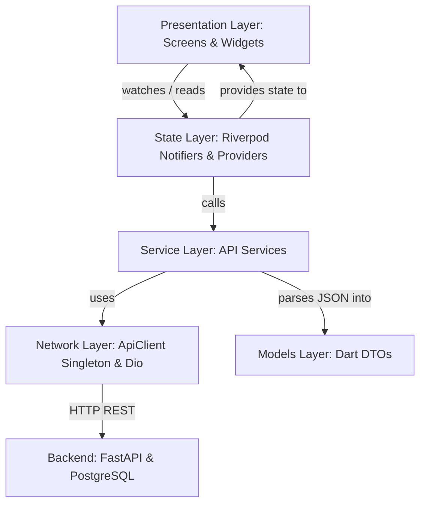

<div align="center">
  <picture>
    <source media="(prefers-color-scheme: dark)" srcset="assets/LOGO_DM.png">
    <source media="(prefers-color-scheme: light)" srcset="assets/LOGO.png">
    
  </picture>
  <br/>
  <h1>SirfBill (Printer) - Printing Store POS & Accounting System</h1>
  <p><strong>Accounting without error</strong> • Multi-Tenant Point of Sale, Granular Stock Inventory, Distributor Billing, and Instant Multi-Format Invoicing</p>
</div>

---

## 📋 Table of Contents

- [Project Overview](#-project-overview)
  - [The Problem It Solves](#the-problem-it-solves)
  - [Core Capabilities](#core-capabilities)
- [Tech Stack](#-tech-stack)
- [Prerequisites](#-prerequisites)
- [Getting Started](#-getting-started)
  - [1. Clone Repository](#1-clone-the-repository)
  - [2. Environment Configuration](#2-set-up-environment-variables)
  - [3. Install Dependencies](#3-install-dependencies)
  - [4. Run on Web](#4-run-on-web)
  - [5. Build Windows Executable (.exe)](#5-build-windows-desktop-executable-exe)
- [Environment Configuration](#-environment-configuration)
- [Project Structure](#-project-structure)
- [Architecture Deep Dive](#-architecture-deep-dive)
- [State Management (Riverpod)](#-state-management-riverpod)
- [Feature Modules](#-feature-modules)
  - [Multi-Tenant POS & Quick Billing](#-multi-tenant-pos--quick-billing)
  - [Printing Inventory & Stock Management](#-printing-inventory--stock-management)
  - [Distributors & Purchase Bills](#-distributors--purchase-bills)
  - [Dynamic Multi-Format Invoices (A4, A5, Thermal)](#-dynamic-multi-format-invoices-a4-a5-thermal)
  - [Financial Accounts, Cash Drawer & Ledger](#-financial-accounts-cash-drawer--ledger)
  - [Bill Customization & Corporate Compliance (CIN)](#-bill-customization--corporate-compliance-cin)
- [Backend API Contract](#-backend-api-contract)
- [Key Design Decisions](#-key-design-decisions)
- [Common Gotchas & Troubleshooting](#-common-gotchas--troubleshooting)
- [Adding a New Feature](#-adding-a-new-feature)
- [Contributing](#-contributing)
- [License](#-license)

---

## 📖 Project Overview

**SirfBill (Printer)** is a high-performance, cloud-connected Point of Sale (POS), inventory management, and financial accounting platform built specifically for **printing stores, digital printing presses, copy & xerox centres, and graphic supply retailers**.

Built on a **Multi-Tenant SaaS Architecture**, a single deployment securely isolates and manages multiple store branches or tenants. Each store gets its own secure domain with isolated stock catalogs, distributor networks, customer ledgers, cash drawer sessions, and customizable invoice templates.

### The Problem It Solves
Printing businesses manage specialized operational workflows that standard generic retail tools struggle with:
- **Corporate & Regulatory Identification**: Printing stores and corporate stationery suppliers must display their **CIN Number (Corporate Identification Number)**, **GSTIN**, and **HSN Codes** prominently on tax invoices.
- **Pack & Loose Unit Mathematics**: Paper stocks (reams vs. sheets, packs vs. units) require precise tracking so items can be sold as whole boxes, individual reams, or loose packs without breaking stock reconciliation.
- **Diverse Hardware Ecosystems**: Print shops need instant switching between 80mm/58mm **Thermal Receipt Printers** for quick counter slips and **A4 / A5 Laser Printers** for corporate tax invoices and GST delivery challans.
- **Distributor Purchase Flow**: Rapid ingestion of wholesale supplier invoices, updating unit buying prices, recalculating stock automatically, and tracking credit or payment balances.

### Core Capabilities
- ⚡ **High-Speed Counter Billing**: Keyboard-shortcut-driven cart additions, live discount recalculations, customer ledger tagging, and split payments (Cash, UPI, Card, Credit).
- 📦 **Granular Item Inventory**: Barcode/SKU scanning, pack sizes, rack locations, low-stock threshold alerts, and instant Excel/CSV/PDF exports.
- 🏢 **Distributor Relationship Management**: Maintain supplier profiles, purchase bills, payment statuses (`PAID`, `UNPAID`), and top-selling product analytics.
- 🖨️ **Client-Side PDF Generation**: Crystal-clear vector invoices formatted for A4, A5, and Thermal receipt formats with zero server rendering lag.
- 📊 **Real-time Financials**: Daily cash drawers, immutable expense and income transactions, and live profit-loss summaries.

---

## 🛠️ Tech Stack

### Frontend Architecture
| Technology | Role | Why We Chose It |
|---|---|---|
| **Flutter Web & Desktop** | Core UI Framework | High-performance canvas-rendered UI sharing a single codebase across Web and native Windows desktop (`SirfBill.exe`). |
| **Riverpod** | State Management | Compile-time safe, decoupled reactive state. Powers the real-time POS cart, search debouncing, and cached distributor lookups. |
| **GoRouter** | Routing & Deep Linking | Declarative stateful routing with sub-routes, browser URL synchronization, and role-based redirect guards. |
| **Dio & Pretty Logger** | Networking | Robust HTTP networking with automatic Bearer token interceptors, unified error formatting, and timeout management. |
| **pdf & printing** | Invoicing Engine | High-resolution client-side PDF document layout (A4, A5, Thermal) rendering directly in Dart without backend bottlenecks. |
| **fl_chart** | Analytics | Smooth vector charts for distributor sales volumes and store revenue trends. |

### Backend Architecture
| Technology | Role | Why We Chose It |
|---|---|---|
| **Python & FastAPI** | Core REST API | Asynchronous, auto-documenting OpenAPI endpoints with strict Pydantic schemas. |
| **SQLAlchemy 2.0** | ORM | Strongly typed database queries with tenant isolation filters on every transaction. |
| **PostgreSQL** | Database | ACID-compliant relational storage for transactional ledgers and stock quantities. |
| **Alembic** | Schema Migrations | Safe, repeatable database schema evolutions. |
| **JWT (Jose)** | Authentication | Stateless authentication passing `tenant_id` and role permissions in secure tokens. |

---

## 📋 Prerequisites

### Frontend Environment
- **Flutter SDK** (`>=3.19.0` / Dart `>=3.3.0`): [Install Flutter](https://docs.flutter.dev/get-started/install)
- **Google Chrome**: For web development and debugging
- **Visual Studio 2022** (Desktop C++ workload): Required only if compiling the native Windows desktop `.exe`

### Backend Environment
- **Python** (`3.10+`): [Install Python](https://www.python.org/downloads/)
- **PostgreSQL** (`14+`): Local PostgreSQL instance or cloud PostgreSQL

---

## 🚀 Getting Started

### 1. Clone the repository
```bash
git clone https://github.com/your-username/sirfbill-printer.git
cd sirfbill-printer
```

### 2. Set up Environment Variables
Create a `.env` file in the project root:
```bash
touch .env
```
Populate your backend API endpoint:
```env
API_BASE_URL=http://127.0.0.1:8000
```

### 3. Install Dependencies
```bash
flutter pub get
```

### 4. Run on Web
Launch the app in Chrome:
```bash
flutter run -d chrome
```

### 5. Build Windows Desktop Executable (.exe)
SirfBill includes a fully configured Windows runner with native branding, multi-resolution transparent icons, and executable metadata:
```bash
flutter build windows --release
```
The compiled release executable will be available at:
```text
build/windows/x64/runner/Release/SirfBill.exe
```

---

## ⚙️ Environment Configuration

SirfBill automatically handles environment switching between local debugging and production hosting.

### Local Development (`.env`)
The app uses `flutter_dotenv` to read `.env` placed in the project root:
```env
API_BASE_URL=http://localhost:8000
```

### Production Deployment (`--dart-define`)
Web browsers aggressively cache static text assets like `.env`. For production builds, inject the API URL directly into the compiled output using `--dart-define`:
```bash
flutter build web --release --dart-define=API_BASE_URL=https://api.yourdomain.com
```

### Resolution Logic (`ApiConstants`)
The [api_constants.dart](file:///Users/sayarpaul/Project/SirfBill(Printer)/lib/config/api_constants.dart) file prioritizes compile-time environment definitions and falls back to `.env`:
```dart
class ApiConstants {
  static String get baseUrl {
    const dartDefineUrl = String.fromEnvironment('API_BASE_URL');
    if (dartDefineUrl.isNotEmpty) {
      return dartDefineUrl;
    }
    return dotenv.env['API_BASE_URL'] ?? 'http://localhost:8000';
  }
}
```

---

## 📂 Project Structure

```text
lib/
├── config/                      # Global configurations
│   ├── api_client.dart          # Singleton Dio client, auth interceptors & logging
│   └── api_constants.dart       # Centralized API base URL & endpoints
│
├── models/                      # Immutable Data Transfer Objects (DTOs)
│   ├── counter_models.dart      # Cart items, Bill, Customer models
│   ├── crm_models.dart          # User & Profile schemas
│   ├── lab_models.dart          # Legacy service models
│   └── settings_models.dart     # ShopSettings (CIN Number, GSTIN, Bank, Address)
│
├── notifiers/                   # Riverpod State Notifiers (Business Logic)
│   ├── accounts_notifier.dart   # Financial ledger & balance state
│   ├── billing_notifier.dart    # Live cart calculations, discounts, taxes
│   ├── category_notifier.dart   # Product category list & mutations
│   ├── customer_notifier.dart   # Customer accounts & balances
│   ├── history_notifier.dart    # Completed invoice search & pagination
│   ├── inventory_notifier.dart  # Stock list, filtering, low-stock alerts
│   ├── rack_notifier.dart       # Storage racks & bin locations
│   └── settings_notifier.dart   # Shop branding & print customization state
│
├── providers/                   # Dependency Injection & Global Providers
│   ├── billing_provider.dart    # Active billing cart provider
│   ├── counter_providers.dart   # Unified POS providers bundle
│   ├── distributor_provider.dart# Distributors, purchase bills & analytics
│   └── theme_provider.dart      # Theme mode provider
│
├── router/                      # Declarative App Navigation
│   └── app_router.dart          # GoRouter configuration & shell navigation
│
├── screens/                     # UI Views
│   ├── auth/
│   │   └── role_login_screen.dart # Role-based authentication (Admin, Counter)
│   ├── counter/                 # Core POS Modules
│   │   ├── accounts_screen.dart           # Cash in Hand & Income/Expense ledger
│   │   ├── add_purchase_bill_screen.dart  # Inward distributor purchase invoices
│   │   ├── bill_customization_screen.dart # Invoice layout, CIN, bank, terms setup
│   │   ├── billing_screen.dart            # Main high-speed billing counter
│   │   ├── counter_dashboard.dart         # Navigation shell & top bar
│   │   ├── customers_screen.dart          # Customer records & credit history
│   │   ├── distributor_detail_screen.dart # Supplier history, bills & item metrics
│   │   ├── distributors_screen.dart       # Distributor directory & KPI cards
│   │   ├── history_screen.dart            # Invoice archive, reprints & refunds
│   │   ├── inventory_screen.dart          # Stock table, search & export actions
│   │   ├── shop_management_screen.dart    # Store branches & settings
│   │   ├── upload_management_screen.dart  # Add new inventory item with photo
│   │   └── widgets/                       # Clean modular component libraries
│   │       ├── accounts/                  # Account metrics, transaction tables
│   │       ├── bill_customization/        # CIN number input, shop detail cards
│   │       ├── billing/                   # Cart table, left item picker, checkout
│   │       ├── customers/                 # Customer metrics & detail panes
│   │       ├── dashboard/                 # Metric widgets & status indicators
│   │       ├── distributors/              # Charts, dialogs & distributor lists
│   │       ├── history/                   # History search, exports & bill details
│   │       ├── inventory/                 # Inventory table, row widgets & dialogs
│   │       ├── purchase/                  # Purchase bill items list, search & modals
│   │       ├── shop/                      # Shop branch cards & forms
│   │       └── upload/                    # Modular upload cards (basic, pricing, info)
│   ├── home/
│   │   └── dashboard_screen.dart          # Overview dashboard & sales charts
│   └── splash/
│       └── splash_screen.dart             # Startup loader & token validator
│
├── services/                    # API Communication Layer
│   ├── account_service.dart     # Financial accounts & ledger calls
│   ├── auth_service.dart        # Login, refresh token & session storage
│   ├── billing_service.dart     # Order creation & checkout submission
│   ├── category_service.dart    # Item categories CRUD
│   ├── customer_service.dart    # Customer directory & balances
│   ├── distributor_service.dart # Supplier CRUD & analytics
│   ├── export_service.dart      # Excel, CSV & PDF export helpers
│   ├── inventory_service.dart   # Stock query, image upload & item CRUD
│   ├── purchase_service.dart    # Inward purchase bills & payments
│   ├── rack_service.dart        # Rack & shelf management
│   ├── shop_service.dart        # Multi-shop branch operations
│   └── shop_settings_service.dart # Shop profile, CIN & invoice settings
│
├── themes/
│   └── app_colors.dart          # Curated color tokens & palette
│
├── utils/                       # Utilities & Document Engines
│   ├── format_utils.dart        # Currency & date formatters
│   ├── pdf_a4_generator.dart    # Standard A4 Tax Invoice PDF generator
│   ├── pdf_a5_generator.dart    # Compact A5 Tax Invoice PDF generator
│   ├── pdf_generator.dart       # Unified document dispatch engine
│   ├── pdf_thermal_generator.dart# 80mm/58mm Thermal receipt layout
│   └── responsive.dart          # Breakpoint utilities (Mobile / Desktop)
│
└── widgets/                     # Reusable Atomic UI Elements
    ├── category_dropdown.dart
    ├── custom_date_range_picker.dart
    ├── custom_pagination.dart
    ├── distributor_dropdown.dart
    ├── horizontal_scroll_wrapper.dart
    └── rack_dropdown.dart
```

---

## 🏛️ Architecture Deep Dive

SirfBill adheres to a **Strict Layered Architecture**:



1. **Presentation Layer (`lib/screens`, `lib/widgets`)**:
   - Built exclusively with `ConsumerWidget` or `ConsumerStatefulWidget`.
   - UI widgets contain **zero HTTP calls** or data manipulation logic.
   - Watches Riverpod providers for automatic re-renders when data updates.
2. **State Layer (`lib/notifiers`, `lib/providers`)**:
   - Manages state life cycles, debounces search keystrokes, and caches API payloads.
   - Handles optimistic updates and local filtering.
3. **Service Layer (`lib/services`)**:
   - Stateless async classes wrapping API endpoints.
   - Returns typed Dart Model instances or throws informative domain exceptions.
4. **Model Layer (`lib/models`)**:
   - Pure Dart classes with `fromJson` and `toMap` methods. Handles safe type parsing and fallback values.

---

## 🧩 Feature Modules

### 🛒 Multi-Tenant POS & Quick Billing
- **Instant Product Search**: Filter printing items by name, barcode SKU, or category with 300ms debounce.
- **Cart Calculations**: Automatically tallies item subtotals, configurable GST rates (0%, 5%, 12%, 18%, 28%), item-level discounts, and bill-level lump-sum discounts.
- **Payment Split**: Record transactions as `PAID`, `PARTIAL`, or `UNPAID` (Credit) linked to specific customer accounts.

### 📦 Printing Inventory & Stock Management
- **Item Categorization**: Organize stocks by categories (e.g., *Paper & Boards*, *Inks & Toners*, *Binding & Finishing*, *Stickers & Labels*).
- **Physical Locations**: Map items to storage racks and bins (e.g., `Rack A-01`, `Shelf B-3`).
- **Pack & Loose Units**: Manage stocks in pack sizes (e.g., 500 sheets/pack) while permitting sales in fractional packs or loose units.
- **Low Stock Thresholds**: Visual badges warn store operators when item stock drops below configured safety levels.

### 🏢 Distributors & Purchase Bills
- **Wholesale Inward Billing**: Record stock replenishment bills from paper mills and equipment distributors.
- **Auto Stock Ingestion**: Creating a purchase bill automatically increments stock counts for items and records the purchase buying price.
- **Payment Reconciliation**: Track invoice totals, paid amounts, outstanding balances, and mark bills as `PAID` with one click.

### 🖨️ Dynamic Multi-Format Invoices (A4, A5, Thermal)
Invoices are compiled on the client device using vector commands from the `pdf` library:
- **A4 Tax Invoice**: Full-width corporate layout with itemized HSN codes, tax slabs (CGST/SGST/IGST), bank payment details, and authorized signature blocks.
- **A5 Invoice**: Clean, compact format ideal for standard walk-in orders.
- **Thermal Receipt (80mm)**: Compact receipt format for thermal roll printers featuring shop header, CIN Number, GSTIN, itemized list, and QR code / payment terms.

```dart
// Generating an A4 Print Document
final pdfBytes = await PdfA4Generator.generateA4Bill(
  bill: currentBill,
  shopSettings: settings,
  cinNumber: settings.cinNumber,
  bankName: settings.bankName,
  acNumber: settings.acNumber,
  ifsc: settings.ifsc,
);

await Printing.layoutPdf(
  onLayout: (PdfPageFormat format) async => pdfBytes,
);
```

### 💰 Financial Accounts, Cash Drawer & Ledger
- **Cash in Hand Tracking**: Live monitoring of daily cash intake vs. disbursements.
- **Transaction Types**: Tag records as `INCOME`, `EXPENSE`, `PURCHASE`, or `REFUND`.
- **Immutable Ledger**: Transactions cannot be silently modified, ensuring financial reports always reconcile.

### 🏢 Bill Customization & Corporate Compliance (CIN)
- **CIN Number Validation**: Dedicated input field strictly validated for the 21-character alphanumeric Indian Corporate Identification Number format (`^[A-Za-z0-9]{21}$`).
- **Invoice Personalization**: Upload shop logo, custom tagline, contact numbers, email, GSTIN, and customizable invoice footer notes.

---

## 🔌 Backend API Contract

The Flutter client communicates with the FastAPI backend over REST:

| Method | Endpoint | Description |
|---|---|---|
| `POST` | `/api/admin/auth/login` | Authenticate user & retrieve JWT access token |
| `GET` | `/api/admin/shops` | List available shops for current tenant |
| `GET` | `/api/admin/shop/inventory` | Fetch paginated inventory list with query filters |
| `POST` | `/api/admin/shop/inventory/add` | Add a new inventory item |
| `PATCH`| `/api/admin/shop/inventory/{id}/update` | Update existing inventory item |
| `DELETE`| `/api/admin/shop/inventory/{id}/delete` | Remove an inventory item |
| `GET` | `/api/admin/distributors/` | Fetch supplier and distributor directory |
| `POST` | `/api/admin/distributors/` | Register a new supplier |
| `GET` | `/api/admin/purchases/` | Fetch inward distributor purchase bills |
| `POST` | `/api/admin/purchases/` | Create purchase bill & increment stock |
| `PATCH`| `/api/admin/purchases/{id}/pay` | Settle purchase bill payment |
| `GET` | `/api/admin/shop/settings` | Retrieve store profile & CIN details |
| `PUT` | `/api/admin/shop/settings` | Update store profile, CIN & bank details |

---

## 🧠 Key Design Decisions

1. **Client-Side PDF Compilation**: Eliminates backend PDF rendering compute cost, supports instant print previews, and works completely offline.
2. **Deterministic Token Interception**: Centralized `ApiClient` singleton automatically injects JWT Bearer tokens and gracefully handles session expiry.
3. **Decoupled Architecture**: Strict separation between Riverpod state notifiers, API services, and DTO models keeps code maintainable and testable.
4. **Native Desktop Windows Runner**: Configured with custom multi-resolution `.ico` icon and metadata for distribution as a standalone Windows executable.

---

## ⚠️ Common Gotchas & Troubleshooting

### 1. Web Caching of Backend URLs
Browsers aggressively cache Flutter Web build assets. Always build production releases with:
```bash
flutter build web --release --dart-define=API_BASE_URL=https://api.yourdomain.com
```

### 2. Windows C++ Diagnostics on macOS (.clangd)
If your editor flags false-positive C++ errors inside `windows/runner/main.cpp` when working on macOS (e.g. `'flutter/dart_project.h' file not found`), [`.clangd`](file:///Users/sayarpaul/Project/SirfBill(Printer)/.clangd) is configured to suppress these platform-mismatched diagnostics. External schema warnings are disabled in [`.vscode/settings.json`](file:///Users/sayarpaul/Project/SirfBill(Printer)/.vscode/settings.json).

### 3. Missing Distributor Name in Inventory Table
When adding items via purchase bills or uploads, both `distributor_id` and `distributor_name` are synchronized. In the UI, [inventory_table_widget.dart](file:///Users/sayarpaul/Project/SirfBill(Printer)/lib/screens/counter/widgets/inventory/inventory_table_widget.dart) uses a fallback lookup against `distributorsProvider` to ensure supplier names always display.

---

## ➕ Adding a New Feature

To add a new module to SirfBill, follow the 5-step clean architecture process:
1. **Model (`lib/models/`)**: Define the data structure with `fromJson` and `toMap`.
2. **Service (`lib/services/`)**: Implement API methods using `ApiClient().dio`.
3. **Notifier (`lib/notifiers/`)**: Create a Riverpod `StateNotifier` to manage state mutations.
4. **Provider (`lib/providers/`)**: Expose the notifier via `StateNotifierProvider`.
5. **UI & Routing (`lib/screens/` & `lib/router/app_router.dart`)**: Build the screen with `ConsumerWidget` and register the route.

---

## 🤝 Contributing

1. Fork the repository
2. Create your feature branch (`git checkout -b feature/NewFeature`)
3. Format your code (`flutter format .`)
4. Verify analysis (`flutter analyze`)
5. Commit your changes (`git commit -m 'feat: Add NewFeature'`)
6. Push to your branch and submit a Pull Request

---

## 📄 License

This software is proprietary and developed for **SirfBill (Printer)**. Unauthorized copying, distribution, or commercial exploitation is strictly prohibited.

Third-party dependencies used in this project remain governed by their respective open-source licenses (MIT, Apache 2.0, BSD). See [pubspec.yaml](file:///Users/sayarpaul/Project/SirfBill(Printer)/pubspec.yaml) for package details.

---

<div align="center">
  <p>Built with ❤️ for printing stores and digital presses everywhere.</p>
</div>
